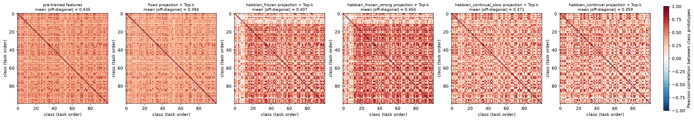
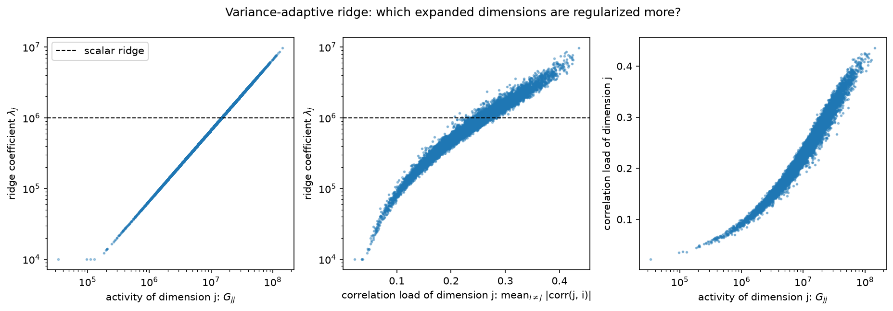

# Results and Outcome Report: Two Extensions of Fly-CL

Setting: CIFAR-100, 10 tasks of 10 classes, ViT-B/16 (`vit_base_patch16_224`), the configuration of
`scripts/test_cifar.sh` (expansion 10000, 300 connections per unit, coding level 0.3, ridge grid
1e6..1e9). Three seeds (1993, 1994, 1995); a seed changes the class order and the random projection.
Hardware: one RTX 3070 (8 GB). Numbers are mean ± std over seeds, from `results/summary.md`.

**Short version: neither extension improves on the original Fly-CL in this setting.** The
learnable projection is slightly but consistently worse, the adaptive ridge is indistinguishable
from the scalar ridge. The analysis below shows why.

## Metrics

- **Avg. acc** — mean over the 10 stages of the accuracy on all classes seen so far.
- **Last acc** — accuracy on all 100 classes after the last task.
- **BWT** — mean over tasks 1..9 of (final accuracy on the task − accuracy right after learning it).
- **Train time** — seconds per task, excluding backbone feature extraction (features are cached
  and identical for every method). Feature extraction itself costs about 19.6 s per task here.

## Main comparison (test set)

| Method | Avg. acc (%) | Last acc (%) | BWT | Train time / task (s) | First-task time (s) |
|---|---|---|---|---|---|
| Fly-CL, fixed projection + scalar ridge (`fixed`) | 92.34 ± 0.63 | 88.72 ± 0.07 | -4.55 ± 0.17 | 9.75 ± 0.03 | 9.80 ± 0.11 |
| T1: Hebbian, frozen after task 1 (`hebbian_frozen`) | 92.04 ± 0.69 | 88.46 ± 0.02 | -4.63 ± 0.30 | 9.72 ± 0.01 | 9.93 ± 0.03 |
| T1: same, stronger learning (`hebbian_frozen_strong`) | 91.86 ± 0.62 | 88.16 ± 0.09 | -4.59 ± 0.40 | 9.70 ± 0.02 | 10.19 ± 0.04 |
| T1: Hebbian on every task (`hebbian_continual`) | 51.54 ± 0.76 | 27.86 ± 0.60 | -77.14 ± 0.71 | 9.76 ± 0.02 | 9.92 ± 0.03 |
| T1: same, 10x smaller lr (`hebbian_continual_slow`) | 83.80 ± 1.11 | 74.53 ± 0.51 | -24.28 ± 0.39 | 9.78 ± 0.03 | 9.96 ± 0.03 |
| T2: adaptive ridge, alpha = 1 (`adaptive_ridge`) | 92.25 ± 0.59 | 88.71 ± 0.07 | -4.54 ± 0.24 | 9.69 ± 0.02 | 9.73 ± 0.02 |
| T2: adaptive ridge, alpha = -1 (`adaptive_ridge_inverse`) | 92.35 ± 0.63 | 88.78 ± 0.08 | -4.46 ± 0.25 | 9.69 ± 0.01 | 9.80 ± 0.08 |
| T1 + T2 (`hebbian_frozen_adaptive_ridge`) | 92.04 ± 0.64 | 88.47 ± 0.04 | -4.62 ± 0.21 | 9.67 ± 0.01 | 9.91 ± 0.04 |

The std of Avg. acc is dominated by the class order, so the paired difference to `fixed` on the
same seed is the fair comparison (mean [min, max] over the 3 seeds):

| Method | Δ Avg. acc | Δ Last acc | Δ BWT |
|---|---|---|---|
| hebbian_frozen | -0.30 [-0.43, -0.21] | -0.27 [-0.34, -0.13] | -0.07 [-0.26, +0.13] |
| hebbian_frozen_strong | -0.47 [-0.55, -0.35] | -0.56 [-0.63, -0.49] | -0.04 [-0.34, +0.21] |
| hebbian_continual | -40.80 [-42.08, -39.47] | -60.86 [-61.73, -60.31] | -72.59 [-73.29, -71.78] |
| hebbian_continual_slow | -8.54 [-9.11, -7.92] | -14.20 [-14.96, -13.78] | -19.73 [-20.32, -19.28] |
| adaptive_ridge | -0.09 [-0.17, -0.01] | -0.01 [-0.07, +0.03] | +0.01 [-0.08, +0.09] |
| adaptive_ridge_inverse | +0.02 [+0.01, +0.02] | +0.06 [-0.06, +0.12] | +0.09 [+0.02, +0.21] |
| hebbian_frozen_adaptive_ridge | -0.29 [-0.38, -0.18] | -0.26 [-0.36, -0.10] | -0.07 [-0.12, +0.00] |

One test image is 0.01 points of Last acc, so differences below about 0.1 are a handful of images.

## Task 1 — Activity-Dependent Learnable Sparse Projection

**Method.** The non-zero pattern of the original projection is the fixed binary mask. On the
active connections, `dW_mu = g_mu (mask_mu * x − <W_mu, x> W_mu)` with `g = 1` for the `hebb_k`
most active units of a sample and `g = −delta` for the next `hebb_k` (BioHash-style); features are
centred and normalised for learning, each row keeps its initial norm, and the same Top-k follows.
The analysis script asserts that the mask is unchanged (300 connections per unit before and after).

**Hyperparameters** were selected on a validation split (10% of the training features of each
task, seed 1993; `results_val/`). Fixed projection on that split: 93.08 avg / 87.88 last.

| lr | epochs | hebb_k | delta | Val avg | Val last |
|---|---|---|---|---|---|
| 0.1 | 1 | 0.01 | 0 | 92.88 | 87.84 |
| 0.5 | 1 | 0.01 | 0 | 92.45 | 87.08 |
| 0.5 | 5 | 0.001 | 0 | 92.87 | 87.66 |
| 0.5 | 5 | 0.01 | 0 | 92.53 | 87.20 |
| 0.5 | 5 | 0.01 | 0.4 | 92.29 | 86.92 |
| 0.5 | 5 | 0.05 | 0 | 92.03 | 86.38 |
| 0.5 | 5 | 0.3 | 0 | 91.78 | 86.30 |
| 1.0 | 10 | 0.01 | 0.4 | 92.32 | 86.82 |
| -0.1 (anti-Hebbian) | 1 | 0.01 | 0 | 92.94 | 87.92 |
| -0.5 (anti-Hebbian) | 5 | 0.01 | 0 | 92.44 | 87.42 |
| -0.5 (anti-Hebbian) | 5 | 0.3 | 0 | 90.43 | 85.30 |

No setting beats the fixed projection; the less the projection learns, the closer it gets to it.
Learning on uncentred features was worse still (92.54 / 86.92 at lr 0.1; 92.04 / 86.22 at lr 0.5,
5 epochs; tested with a temporary edit, not kept in the code). The final runs use the best
Hebbian setting (lr 0.1, 1 epoch, hebb_k 0.01, the defaults) and a deliberately stronger one
(lr 0.5, 5 epochs) to show the trend.

**Representation decorrelation.** Mean absolute off-diagonal Pearson correlation between the
100 class prototypes (lower = more decorrelated), `results/analysis/prototype_correlation_seed*.png`:

| Representation | All classes | First-task classes | Later-task classes | Row cosine to initial W |
|---|---|---|---|---|
| Pre-trained features (before projection) | 0.435 | 0.460 | 0.434 | — |
| Fixed projection + Top-k | 0.395 ± 0.002 | 0.420 | 0.395 | 1 |
| Hebbian frozen + Top-k | 0.382 ± 0.018 | **0.149** | 0.414 | 0.905 |
| Hebbian frozen strong + Top-k | 0.433 ± 0.015 | 0.159 | 0.469 | 0.446 |
| Hebbian continual slow + Top-k (final W) | 0.377 ± 0.006 | 0.403 | 0.377 | 0.960 |
| Hebbian continual + Top-k (final W) | 0.399 ± 0.030 | 0.437 | 0.398 | 0.539 |



**Findings.**

- The frozen Hebbian projection strongly decorrelates the classes it was trained on (0.42 → 0.15)
  but makes the 90 classes of later tasks *more* correlated than the random projection does
  (0.395 → 0.414, and → 0.469 with stronger learning). The units become tuned to the first task
  and lose the task-agnostic coverage of a random projection. Over all 100 classes the net
  effect is within seed noise for the weak setting and clearly worse for the strong one.
- The better decorrelation of first-task prototypes does not give better first-task accuracy
  (98.30 fixed vs 97.83 Hebbian right after task 1; 87.83 vs 87.33 at the end). The ridge solve
  already removes prototype correlation through `(G + λI)^-1`, so decorrelating earlier is redundant.
- Continual updates are not viable with streaming statistics: `G` and `Q` of old tasks were
  accumulated under an older projection and cannot be recomputed without exemplars. Even a
  drift of 4% in row direction (cosine 0.96, `hebbian_continual_slow`) costs 14 points of last
  accuracy and BWT −24; the default lr gives BWT −77. Note that the *final* continual projection
  decorrelates prototypes of all classes a little better than the random one (0.377 vs 0.395),
  i.e. seeing all tasks helps the projection itself; it is the stale statistics that break.
- Cost: the Hebbian pass adds about 0.15 s (0.4 s for the strong setting) to the first task only.

## Task 2 — Variance-Adaptive Generalized Ridge

**Method.** `Λ = diag(λ_j)`, `λ_j = λ_GCV · s_j`, `s_j = (G_jj / mean_i G_ii)^alpha`, clamped to
`[0.01, 100]` and normalised to mean 1; `G_jj` is the accumulated activity of expanded dimension `j`.
`G`, `Q` and GCV are unchanged and the system `(G + Λ) W = Q` is solved by Cholesky.

**Validation (seed 1993; scalar ridge 93.08 / 87.88).**

| alpha | -2 | -1 | -0.5 | 0.25 | 0.5 | 1 | 2 | 4 |
|---|---|---|---|---|---|---|---|---|
| Val avg | 92.96 | 93.09 | 93.07 | 93.05 | 93.06 | 93.06 | 92.88 | 92.58 |
| Val last | 88.06 | 87.98 | 88.04 | 87.86 | 87.86 | 87.80 | 87.90 | 87.90 |

Accuracy is flat for |alpha| ≤ 1. The final runs use alpha = 1 (ridge on variance-standardised
dimensions, the principled choice) and alpha = −1 (nominally best on validation).

**Which dimensions get the stronger ridge?** (`results/analysis/adaptive_ridge_seed*.png`)



- Activity is very uneven: `G_jj` spans 6e4 to 1.3e8 (median 1.1e7), more than three orders of
  magnitude, because Top-k keeps some units active for almost every image.
- Activity and correlation go together: the Spearman correlation between `G_jj` and the
  correlation load of a dimension (mean absolute correlation with all other dimensions) is
  0.989 ± 0.0004. With alpha = 1, `λ_j` therefore ranges from 1e4 (lower clamp) to 9e6 around the
  scalar value 1e6, and **the highly active dimensions, which are also the highly correlated
  ones, receive the stronger regularization** (Spearman of `λ_j` with correlation load: 0.989).

**Numerical conditioning** of the final system `G + Λ` (float64 eigenvalues, 3 seeds):

| Ridge | cond(G + Λ) | cond after diagonal (Jacobi) scaling |
|---|---|---|
| scalar (original) | 5.3e4 ± 0.07e4 | 1.8e5 ± 0.1e5 |
| adaptive, alpha = 1 | 1.05e6 ± 0.34e6 | 3.6e4 ± 0.01e4 |
| adaptive, alpha = −1 | 9.8e4 ± 0.3e4 | 4.5e5 ± 0.3e5 |

The plain condition number gets about 20x worse with alpha = 1, because weakly active dimensions
receive a much smaller ridge and the smallest eigenvalue drops. After symmetric diagonal scaling,
which is what determines the accuracy of a Cholesky solve, the alpha = 1 system is about 5x better
conditioned than the scalar one. Neither effect is visible in accuracy: all systems solve fine in
float32.

**Findings.** Accuracy, BWT and training time are unchanged within noise (paired Δ last acc −0.01
for alpha = 1, +0.06 for alpha = −1). Two reasons are consistent with the data: GCV selects 1e6,
the lower edge of the grid, in every task of every run, so regularization is already weak relative
to the typical `G_jj` (1e7) and redistributing it across dimensions changes little; and with 10000
sparse dimensions the classifier is robust to how the shrinkage is shared. Training time is the
same because the solve is still one Cholesky factorization.

## Outcome

- Both tasks are implemented as specified and evaluated on all requested metrics.
- Task 1: the stable (frozen) Hebbian projection costs 0.3 points of average and last accuracy;
  continual updates break the streaming statistics. The learned projection decorrelates only the
  classes it has seen.
- Task 2: the adaptive ridge matches the scalar ridge in accuracy, BWT and time; it gives stronger
  regularization to highly active, highly correlated dimensions and improves the diagonally scaled
  conditioning, while worsening the plain condition number.
- The original fixed random projection with scalar ridge remains the best configuration tested.

## Limitations

- One dataset (CIFAR-100) and one backbone; CUB-200-2011 and VTAB need a manual download and
  were not run.
- Three seeds. Effects below about 0.1 points should be read as "no difference".
- GCV always sits on the lower edge of the ridge grid given in `scripts/test_cifar.sh`; the
  original grid was kept on purpose, so the adaptive ridge was not tested with a wider grid.
- The explanation of why the frozen Hebbian projection does not help is supported by the
  first-task / later-task split above, but was not tested with other learning rules (for example
  rules that explicitly decorrelate units).

## Reproduce

```bash
source .venv/bin/activate                 # torch, torchvision, timm 0.9.16, huggingface_hub 0.23.5
experiments/run_all.sh                    # all test-set runs (about 50 min on an RTX 3070)
for s in 1993 1994 1995; do python experiments/analyze.py --seed $s; done
python experiments/summarize.py > results/summary.md
# validation sweep: python experiments/make_val_cache.py cache/cifar100_vit_seed1993 cache/cifar100_vit_seed1993_val
#                   experiments/sweep_val.sh
```
